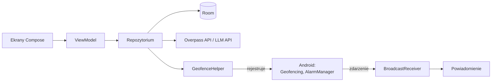

# Skrót HLD – ekrany i architektura

Aplikacja na Androida (Kotlin): zadania i notatki w kalendarzu, które przypominają o sobie o godzinie albo gdy użytkownik jest w pobliżu miejsca, w którym może je wykonać. Pełny opis: [HLD.md](HLD.md).

## Ekrany

Nawigacja: dolny pasek **Kalendarz · Notatki · Miejsca · Ustawienia**; edytor zadania i wybór miejsca otwierają się na wierzchu.

| Ekran | Co na nim jest |
| --- | --- |
| **Kalendarz** (start) | Widok miesiąc/tydzień, kropki przy dniach z zadaniami · lista zadań wybranego dnia (checkbox „zrobione”, ikona zegara/pinezki) · przycisk **+** dodaje zadanie |
| **Edycja zadania** | Tytuł, opis · data i godzina (lub „bez daty”) · przypomnienie czasowe (np. 15 min przed) · lokalizacja: brak / DOM / PRACA / punkt na mapie / kategoria (sklep, apteka, paczkomat…) · lista podzadań · przycisk **Podpowiedz (AI)** – proponuje podzadania i lokalizację do zaakceptowania |
| **Wybór miejsca** | Mapa z wyszukiwarką adresu i pinezką **albo** lista kategorii · podgląd znalezionych punktów w okolicy · zapisz |
| **Notatki** | Lista notatek (przypiętych do dnia lub zadania) · wyszukiwanie · edytor tekstu notatki |
| **Miejsca** | DOM i PRACA (ustawienie na mapie) · inne zapisane miejsca · liczba zadań przypisanych do każdego |
| **Ustawienia** | Status uprawnień (powiadomienia, lokalizacja „zawsze”) z przyciskiem nadania · cisza nocna · domyślny promień strefy |
| **Powiadomienie** | „Jesteś blisko: Market budowlany – Kupić żarówki” · akcje: **Zrobione**, **Później**, **Nawiguj** |

## Jak działa przypomnienie lokalizacyjne

1. Przy zapisie zadania z lokalizacją aplikacja ustala punkty: konkretny punkt albo do 5 najbliższych miejsc z kategorii wokół DOM i PRACA (OpenStreetMap / Overpass).
2. Dla każdego punktu rejestruje w Androidzie geofence (okrąg 150–200 m). Aplikacja nie śledzi GPS – budzi ją system.
3. Geofence ma typ **DWELL** z opóźnieniem 60 s, więc przejazd obok sklepu nie wywoła powiadomienia.
4. Po zdarzeniu aplikacja sprawdza, czy zadanie jest jeszcze aktywne i czy nie przypominała o nim w ostatnich 4 h, potem pokazuje powiadomienie.
5. Po zrobieniu zadania jego geofence’y są usuwane; po restarcie telefonu – rejestrowane ponownie.

Limit Androida to 100 geofence’ów na aplikację – przy prostym użyciu to wystarczy; przy przekroczeniu bierzemy zadania z najbliższym terminem.

## Architektura

Jeden moduł `app`, wzorzec MVVM, bez osobnych warstw domeny i bez backendu.

| Pakiet | Zawartość |
| --- | --- |
| `ui/` | Ekrany Compose + ViewModel na ekran, Navigation Compose |
| `data/` | Room: `Task`, `Note`, `Place` (+ `TaskPlace`), DAO, `TaskRepository` |
| `location/` | `GeofenceHelper` (dodaj/usuń strefy), `GeofenceReceiver`, `PlacesApi` (Overpass) |
| `reminders/` | `AlarmScheduler` (przypomnienia czasowe), `AlarmReceiver`, `BootReceiver`, `Notifications` |
| `ai/` | `AiClient` – jedno zapytanie do LLM zwracające JSON z podzadaniami i kategorią miejsca |

**Technologie:** Kotlin, Jetpack Compose (Material 3), ViewModel + Coroutines/Flow, Room, Retrofit, Google Play Services Location, osmdroid lub Google Maps Compose. DI ręcznie (jeden obiekt `AppContainer`) zamiast Hilta.

**Uprawnienia:** powiadomienia (Android 13+), lokalizacja dokładna, lokalizacja w tle („Zezwalaj zawsze” – wymagana do geofencingu), dokładne alarmy (opcjonalnie).