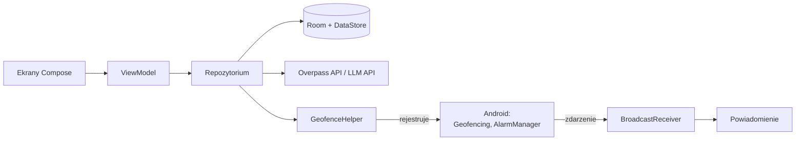

# Skrót HLD – ekrany i architektura

**Blisko** – aplikacja na Androida (Kotlin): zadania i notatki w kalendarzu, które przypominają o sobie o godzinie albo gdy użytkownik jest w pobliżu miejsca, w którym może je wykonać. Pełny opis: [HLD.md](HLD.md). Makieta: [Figma Make](https://www.figma.com/make/fm86xhhltRsuyyrgeF4j7U/Android-Task-Reminder-App).

## Ekrany

Nawigacja: dolny pasek **Kalendarz · Notatki · Miejsca · Ustawienia**. Edytor zadania i wybór miejsca otwierają się na wierzchu jako dolne arkusze (bottom sheet).

| Ekran | Co na nim jest |
| --- | --- |
| **Kalendarz** (start) | Nagłówek z dzisiejszą datą · widok tydzień/miesiąc (przełącznik T/M, strzałki zmiany zakresu), kropki przy dniach z zadaniami · sekcja „Do zrobienia” z liczbą otwartych zadań · karty zadań: checkbox „zrobione”, opis, miejsce (pinezka) lub godzina (zegar), kolorowy akcent · przycisk **+ Nowe zadanie** |
| **Edycja zadania** (arkusz) | **Anuluj / Zapisz** · nazwa i opis · **Podpowiedz z AI** („Podzadania i najlepsze miejsce”) – wstawia propozycję podzadań i kategorii miejsca · **KIEDY:** data, godzina, przypomnienie (o czasie / 5 / 15 / 30 min / 1 godz. wcześniej) · **GDZIE:** wybrane miejsce z promieniem (np. „300 m od lokalizacji”) – otwiera wybór miejsca · **PODZADANIA:** lista + „Dodaj” |
| **Wybór miejsca** (arkusz) | **Zamknij / Gotowe** · wyszukiwarka adresu lub nazwy · mapa z pinezką i okręgiem promienia · kategorie: Sklep, Apteka, Paczkomat, Inne · lista „W pobliżu” (nazwa, godziny otwarcia, odległość) do zaznaczenia |
| **Notatki** | Wyszukiwarka · filtry **Wszystkie / Przypięte / Powiązane** (z dniem lub zadaniem) · karty notatek z datą i powiązaniem · przycisk **+** dodaje notatkę |
| **Miejsca** | Mini-mapa z pinezkami zapisanych miejsc i przyciskiem „moja lokalizacja” · lista: Dom, Praca i inne miejsca (np. „Mama”) z adresem i liczbą przypisanych zadań · **Dodaj nowe miejsce** (otwiera wybór miejsca) |
| **Ustawienia** | Panel stanu („Przypomnienia działają”) · **Uprawnienia:** powiadomienia, lokalizacja „Zawsze” – z przejściem do nadania · **Przypomnienia:** cisza nocna (przełącznik, np. 22:00–07:00), domyślny promień (300 m), domyślne wyprzedzenie (15 min) · informacja, że dane o położeniu zostają na urządzeniu |
| **Powiadomienie** (poza makietą) | „Jesteś blisko: Sklep budowlany – Kupić żarówki” · akcje: **Zrobione**, **Później**, **Nawiguj** |

## Jak działa przypomnienie lokalizacyjne

1. Przy zapisie zadania z lokalizacją aplikacja ustala punkty: miejsce wybrane z listy „W pobliżu” lub zapisane (Dom, Praca…) albo – dla samej kategorii – do 5 najbliższych punktów wokół Domu i Pracy (OpenStreetMap / Overpass).
2. Dla każdego punktu rejestruje w Androidzie geofence (okrąg o domyślnym promieniu z ustawień – 300 m). Aplikacja nie śledzi GPS – budzi ją system.
3. Geofence ma typ **DWELL** z opóźnieniem 60 s, więc przejazd obok sklepu nie wywoła powiadomienia.
4. Po zdarzeniu aplikacja sprawdza, czy zadanie jest jeszcze aktywne, czy nie przypominała o nim w ostatnich 4 h i czy nie trwa cisza nocna, potem pokazuje powiadomienie.
5. Po zrobieniu zadania jego geofence’y są usuwane; po restarcie telefonu – rejestrowane ponownie.

Limit Androida to 100 geofence’ów na aplikację – przy prostym użyciu to wystarczy; przy przekroczeniu bierzemy zadania z najbliższym terminem.

## Architektura

Jeden moduł `app`, wzorzec MVVM, bez osobnych warstw domeny i bez backendu.

| Pakiet | Zawartość |
| --- | --- |
| `ui/` | Ekrany Compose (4 zakładki + 2 arkusze) z ViewModelami, Navigation Compose |
| `data/` | Room: `Task` (podzadania przez `parentId`), `Note`, `Place` (+ `TaskPlace`), DAO, `TaskRepository` · `SettingsStore` (DataStore: cisza nocna, promień, wyprzedzenie) |
| `location/` | `GeofenceHelper` (dodaj/usuń strefy), `GeofenceReceiver`, `PlacesApi` (Overpass) |
| `reminders/` | `AlarmScheduler` (przypomnienia czasowe), `AlarmReceiver`, `BootReceiver`, `Notifications` |
| `ai/` | `AiClient` – jedno zapytanie do LLM zwracające JSON z podzadaniami i kategorią miejsca |

**Technologie:** Kotlin, Jetpack Compose (Material 3), ViewModel + Coroutines/Flow, Room, DataStore, Retrofit, Google Play Services Location, osmdroid lub Google Maps Compose. DI ręcznie (jeden obiekt `AppContainer`) zamiast Hilta.

**Uprawnienia:** powiadomienia (Android 13+), lokalizacja dokładna, lokalizacja w tle („Zezwalaj zawsze” – wymagana do geofencingu), dokładne alarmy (opcjonalnie).
