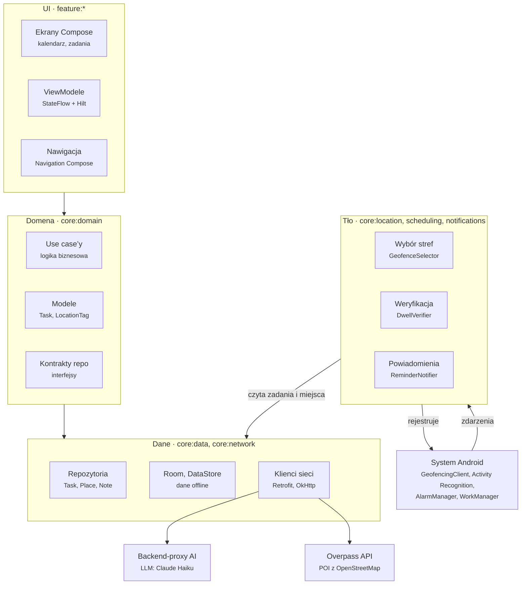
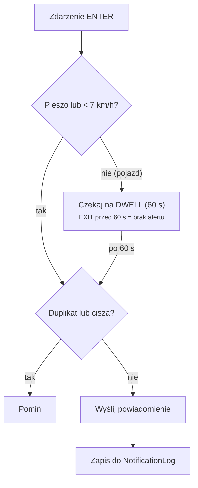

# HLD – Kalendarz z notatkami i przypomnieniami lokalizacyjnymi (Android/Kotlin)

Stan na: 2026-10-15

## 1. Cel i zakres

Aplikacja na Androida (Kotlin) łączy kalendarz, notatki i przypomnienia: zadanie przypomina o sobie o określonej godzinie albo gdy użytkownik znajdzie się w pobliżu miejsca, w którym da się je wykonać. Projekt powstaje na zajęcia „Aplikacje mobilne” (AGH).

**W zakresie (MVP):**

- Kalendarz (widok dnia, tygodnia, miesiąca) z zadaniami i wydarzeniami.
- Notatki przypięte do zadania lub dnia.
- Przypomnienia czasowe (o konkretnej godzinie, z wyprzedzeniem).
- Przypomnienia lokalizacyjne: zadanie ma miejsce konkretne (np. paczkomat WAW123) albo kategorię miejsc (np. market budowlany); wejście w strefę wywołuje powiadomienie.
- Stałe miejsca użytkownika: DOM i PRACA.
- AI, które z tekstu zadania proponuje podzadania i tag lokalizacyjny.

**Poza zakresem:** synchronizacja między urządzeniami, współdzielenie kalendarza, iOS, integracja z Google Calendar (możliwe rozszerzenie).

## 2. Wymagania

**Funkcjonalne**

| ID | Wymaganie |
| --- | --- |
| F1 | Użytkownik tworzy, edytuje i usuwa zadania z datą, godziną, opisem i notatką. |
| F2 | Zadanie może mieć przypomnienie czasowe, lokalizacyjne lub oba. |
| F3 | Lokalizacja zadania: KONKRETNY_PUNKT (współrzędne / adres) albo PUNKTY_POI (kategoria, np. apteka). |
| F4 | Użytkownik definiuje miejsca stałe DOM i PRACA (wybór na mapie). |
| F5 | AI rozbija zadanie na podzadania i proponuje tag lokalizacyjny; użytkownik akceptuje lub poprawia. |
| F6 | Powiadomienie lokalizacyjne pojawia się po wejściu w strefę i spełnieniu warunku dwell (≥ 60 s lub ruch pieszy). |
| F7 | Z powiadomienia można: oznaczyć jako zrobione, odłożyć (snooze), otworzyć nawigację. |
| F8 | Widok kalendarza dzień / tydzień / miesiąc + lista zadań bez daty. |

**Niefunkcjonalne**

| ID | Wymaganie |
| --- | --- |
| N1 | Bateria: brak ciągłego GPS w tle; tylko geofencing systemowy + Activity Recognition. Cel: < 2% baterii dziennie przez aplikację. |
| N2 | Offline-first: zadania, notatki i przypomnienia czasowe działają bez internetu (Room). Internet potrzebny tylko do AI i wyszukiwania POI. |
| N3 | Prywatność: historia lokalizacji nie jest zapisywana ani wysyłana; do AI trafia wyłącznie treść zadania. |
| N4 | minSdk 26 (Android 8.0), targetSdk 35; poprawna obsługa uprawnień Androida 10+ (tło), 12+ (dokładne alarmy), 13+ (powiadomienia). |
| N5 | Przypomnienia przetrwają restart telefonu i aktualizację aplikacji. |

## 3. Architektura wysokopoziomowa

Aplikacja stosuje MVVM + Clean Architecture: UI zależy od domeny, domena nie zależy od niczego, a warstwa danych i warstwa tła implementują jej kontrakty.



Warstwa tła nie ma własnej pętli: system Android wywołuje ją zdarzeniami (geofence, alarm, Worker), a `DwellVerifier` decyduje, czy użytkownik dostanie powiadomienie.

## 4. Moduły aplikacji

Projekt jest wielomodułowym projektem Gradle; moduły `feature:*` zależą tylko od `core:*`, nigdy od siebie nawzajem.

| Moduł Gradle | Odpowiedzialność | Kluczowe klasy |
| --- | --- | --- |
| `app` | Punkt wejścia, nawigacja, DI, manifest, receivery | `MainActivity`, `AppNavHost`, `BootReceiver` |
| `feature:calendar` | Widoki dnia/tygodnia/miesiąca | `CalendarScreen`, `CalendarViewModel` |
| `feature:tasks` | Tworzenie/edycja zadania, podzadania, sugestie AI | `TaskEditorScreen`, `TaskEditorViewModel` |
| `feature:notes` | Notatki przypięte do zadania lub dnia | `NoteEditorScreen` |
| `feature:places` | Mapa, DOM/PRACA, wybór punktu, kategorie POI | `PlacePickerScreen` |
| `feature:settings` | Uprawnienia, promień stref, tryb cichy | `SettingsScreen`, `PermissionFlow` |
| `core:domain` | Modele i use case’y (czysty Kotlin) | `Task`, `LocationTag`, `CreateTaskUseCase` |
| `core:data` | Repozytoria, Room, DataStore, mapery | `TaskRepository`, `AppDatabase` |
| `core:location` | Geofencing, Activity Recognition, wybór stref | `GeofenceManager`, `GeofenceSelector`, `DwellVerifier` |
| `core:notifications` | Kanały, budowanie powiadomień, akcje | `ReminderNotifier`, `NotificationActionReceiver` |
| `core:scheduling` | Alarmy czasowe i zadania WorkManagera | `AlarmScheduler`, `DailyGeofenceRefreshWorker` |
| `core:network` | Klienci AI i POI (Retrofit/Ktor) | `AiTaskApi`, `PlacesApi` |
| `core:ui` | Motyw Material 3, wspólne komponenty | `AppTheme` |

## 5. Moduł lokalizacji i geofencingu

Aplikacja nie śledzi użytkownika: rejestruje w systemie ograniczoną pulę okręgów (geofence) i reaguje dopiero na zdarzenie od systemu. GPS w tle nie jest włączany przez aplikację; lokalizację dostarcza Fused Location Provider w trybie pasywnym/oszczędnym.

**Komponenty `core:location`**

- `GeofenceSelector` – wybiera, które punkty zarejestrować (budżet, priorytety).
- `GeofenceManager` – opakowanie na `GeofencingClient`: `add`, `remove`, `replaceAll`.
- `GeofenceBroadcastReceiver` – odbiera zdarzenia ENTER / DWELL / EXIT i przekazuje je do `DwellVerifier`.
- `ActivityTransitionTracker` – subskrypcja Activity Recognition (Transition API): IN_VEHICLE, ON_BICYCLE, WALKING, STILL; ostatni stan w DataStore.
- `DwellVerifier` – decyduje, czy wysłać powiadomienie.

**Budżet stref.** Android pozwala na maks. 100 aktywnych geofence na aplikację. Zakładamy limit roboczy 90 + 1 strefa „odświeżająca”:

1. KONKRETNY_PUNKT – zawsze rejestrowany (jeśli zadanie aktywne), promień 150 m.
2. PUNKTY_POI – dla każdej kategorii maks. 5 najbliższych miejsc wokół DOM, PRACA i bieżącej pozycji (promień wyszukiwania 5 km), promień strefy 200 m.
3. Priorytet przy przekroczeniu budżetu: termin zadania (najbliższy pierwszy), potem odległość od użytkownika.
4. Strefa odświeżająca: okrąg ok. 3 km wokół pozycji z chwili rejestracji; zdarzenie EXIT uruchamia ponowny wybór stref wokół nowej pozycji („przesuwane okno”).

**Kiedy strefy są przeliczane:** codziennie rano (`DailyGeofenceRefreshWorker`), po dodaniu/zmianie/zakończeniu zadania, po EXIT strefy odświeżającej, po restarcie telefonu (`BootReceiver`) i po aktualizacji aplikacji (`MY_PACKAGE_REPLACED`).

**Reguła wyzwolenia (dwell).** Strefy są rejestrowane z przejściami `ENTER | DWELL` i `loiteringDelay = 60 000 ms`.

1. ENTER, a ostatnia aktywność to WALKING lub STILL, albo prędkość z `triggeringLocation` < 7 km/h → powiadomienie od razu.
2. ENTER, a aktywność to IN_VEHICLE lub prędkość ≥ 7 km/h → czekamy na DWELL.
3. DWELL (użytkownik jest w strefie ≥ 60 s) → powiadomienie.
4. Deduplikacja: jedno powiadomienie na zadanie na 4 h oraz jedno na miejsce przy wielu zadaniach w tym samym punkcie (grupowanie).
5. Wyciszenie: poza oknem czasowym zadania (np. zadanie na jutro) i w godzinach ciszy nocnej powiadomienie nie jest wysyłane.

Dokładność geofencingu w praktyce to ok. 100–200 m, a opóźnienie zdarzenia może sięgnąć kilku minut (zwłaszcza w trybie Doze) – dlatego promień poniżej 150 m nie ma sensu.

## 6. Integracja AI i wyszukiwanie miejsc

AI tylko proponuje – o podzadaniach i lokalizacji decyduje użytkownik jednym kliknięciem „Akceptuj”. Dzięki temu błędna sugestia nigdy sama nie tworzy strefy.

**Dekompozycja zadania.** Tekst zadania (np. „Kupić żarówki i odebrać paczkę”) trafia do LLM z wymuszonym wyjściem JSON:

```json
{
  "subtasks": [
    {"title": "Kupić żarówki", "location": {"type": "POI_CATEGORY", "category": "hardware_store"}},
    {"title": "Odebrać paczkę", "location": {"type": "SPECIFIC_POINT", "query": "Paczkomat WAW123"}}
  ]
}
```

- Kategorie POI to zamknięta lista (enum) zdefiniowana w aplikacji, np. `grocery`, `pharmacy`, `hardware_store`, `parcel_locker`, `post_office`, `bank_atm` – LLM wybiera z niej, nie wymyśla własnych.
- `type` może być też `HOME`, `WORK` lub `NONE`.
- Model: mały i tani model LLM (np. Claude Haiku), wywoływany przez cienki backend-proxy, żeby klucz API nie trafił do APK.
- Fallback offline: prosty słownik słów kluczowych („apteka” → `pharmacy`, „paczkę” → `parcel_locker`).

**Wyszukiwanie POI.** `PlacesRepository` zamienia kategorię na listę punktów w promieniu 5 km od DOM, PRACA i bieżącej pozycji. Domyślnie OpenStreetMap (Overpass API – darmowe, tagi `shop=hardware`, `amenity=pharmacy`), alternatywnie Google Places API (New). Wyniki są cache’owane w Room na 7 dni, więc poranne odświeżenie zwykle nie wymaga sieci.

**KONKRETNY_PUNKT** jest geokodowany raz (Nominatim lub Geocoder Androida) albo wskazywany pinezką na mapie; współrzędne zapisujemy przy zadaniu.

## 7. Model danych

Wszystkie dane leżą lokalnie w Room (SQLite); ustawienia i ostatni stan aktywności w DataStore.

| Encja | Pola | Relacje |
| --- | --- | --- |
| `TaskEntity` | id, title, description, dueAt?, allDay, status (TODO/DONE), priority, parentId?, createdAt | 1–N podzadania (parentId), 1–N `NoteEntity`, 1–N `ReminderEntity`, 0–1 `TaskLocationEntity` |
| `NoteEntity` | id, taskId?, date?, content (Markdown), updatedAt | N–1 zadanie lub dzień |
| `ReminderEntity` | id, taskId, type (TIME/LOCATION), triggerAt?, offsetMinutes?, enabled | N–1 zadanie |
| `TaskLocationEntity` | taskId, type (SPECIFIC_POINT/POI_CATEGORY/HOME/WORK), placeId?, category?, radiusM | N–N z `PlaceEntity` przez `TaskPlaceCrossRef` |
| `PlaceEntity` | id, name, lat, lng, category?, source (USER/OSM/GOOGLE), fetchedAt | używane przez wiele zadań |
| `UserPlaceEntity` | kind (HOME/WORK), placeId | 1–1 `PlaceEntity` |
| `ActiveGeofenceEntity` | requestId, placeId, radiusM, registeredAt | odwzorowanie tego, co jest w systemie |
| `NotificationLogEntity` | taskId, placeId, firedAt | deduplikacja (4 h) |

`ActiveGeofenceEntity` jest potrzebna, bo `GeofencingClient` nie pozwala odczytać listy zarejestrowanych stref – po restarcie aplikacja odtwarza je z tej tabeli. `requestId` ma postać `place:<placeId>`, więc jedna strefa obsługuje wiele zadań w tym samym miejscu.

## 8. Kluczowe przepływy

**A. Dodanie zadania z lokalizacją**

1. Użytkownik wpisuje „Kupić żarówki” w `TaskEditorScreen`.
2. `SuggestTaskBreakdownUseCase` wysyła tekst do backendu AI i dostaje podzadania z tagiem `POI_CATEGORY: hardware_store`.
3. Użytkownik akceptuje lub poprawia sugestię; `CreateTaskUseCase` zapisuje zadanie w Room.
4. `PlacesRepository` pobiera (lub bierze z cache) markety budowlane w promieniu 5 km od DOM, PRACA i bieżącej pozycji.
5. `GeofenceSelector` przelicza pulę stref, a `GeofenceManager` podmienia zarejestrowane geofence’y.

**B. Poranne odświeżenie** (`DailyGeofenceRefreshWorker`, ok. 6:00)

1. Pobranie aktywnych zadań z lokalizacją (status TODO, termin ≤ 7 dni lub bez terminu).
2. Odświeżenie cache POI starszego niż 7 dni.
3. Wybór maks. 90 stref + strefa odświeżająca, rejestracja w systemie, zapis do `ActiveGeofenceEntity`.

**C. Wejście w strefę**



Powiadomienie obejmuje wszystkie aktywne zadania przypisane do tego miejsca; po wysłaniu wpis w `NotificationLogEntity` blokuje kolejne przez 4 h.

## 9. Powiadomienia, praca w tle i uprawnienia

Aplikacja nie ma stałego serwisu w tle (foreground service); każda praca w tle jest wywoływana przez system: alarm, geofence, Activity Recognition albo WorkManager.

**Mechanizmy w tle**

| Mechanizm | Do czego | Uwagi |
| --- | --- | --- |
| `AlarmManager.setExactAndAllowWhileIdle` | Przypomnienia czasowe | Wymaga `SCHEDULE_EXACT_ALARM` (Android 12+); bez zgody – `setWindow` z tolerancją ok. 10 min |
| `GeofencingClient` + `PendingIntent` → BroadcastReceiver | Wejście/dwell w strefie | Receiver robi krótką pracę przez `goAsync()` lub zleca `OneTimeWorkRequest` |
| Activity Recognition Transition API | Stan ruchu (pieszo / pojazd) | Tylko zapis ostatniego stanu do DataStore |
| WorkManager (`PeriodicWorkRequest`, 24 h) | Poranne przeliczenie stref, odświeżenie cache POI | Warunek: sieć dostępna dla pobrania POI |
| `BootReceiver` | Odtworzenie alarmów i stref po restarcie | `RECEIVE_BOOT_COMPLETED` |

**Powiadomienia.** Dwa kanały: „Przypomnienia czasowe” i „Przypomnienia w pobliżu” (użytkownik wycisza je osobno). Akcje: *Zrobione*, *Przypomnij za 1 h*, *Nawiguj* (intencja `geo:` do Map Google). Kilka zadań w jednym miejscu = jedno powiadomienie grupowe.

**Uprawnienia – kolejność pytania (stopniowo, nie wszystko na starcie):**

1. `POST_NOTIFICATIONS` (Android 13+) – przy pierwszym przypomnieniu.
2. `ACCESS_FINE_LOCATION` – przy pierwszym zadaniu z lokalizacją.
3. `ACCESS_BACKGROUND_LOCATION` – osobny ekran z wyjaśnieniem, potem przekierowanie do ustawień („Zezwalaj zawsze”); bez niego geofencing nie działa.
4. `ACTIVITY_RECOGNITION` (Android 10+) – opcjonalne; bez niego zostaje sam DWELL 60 s.
5. `SCHEDULE_EXACT_ALARM` – opcjonalne, z ustawień.

Dodatkowo aplikacja proponuje wyłączenie optymalizacji baterii dla siebie (ważne na Xiaomi, Huawei, Samsung).

**Prywatność.** Pozycja użytkownika nie jest zapisywana ani wysyłana. Do API POI trafiają jedynie współrzędne środka wyszukiwania (DOM/PRACA/bieżąca), a do AI wyłącznie treść zadania.

## 10. Stos technologiczny

| Obszar | Wybór |
| --- | --- |
| Język / build | Kotlin 2.x, Gradle Kotlin DSL, version catalog (`libs.versions.toml`) |
| UI | Jetpack Compose, Material 3, Navigation Compose |
| Architektura | MVVM + Clean Architecture (UI → ViewModel → UseCase → Repository) |
| Asynchroniczność | Kotlin Coroutines + Flow (`StateFlow` w ViewModelach) |
| DI | Hilt |
| Baza danych | Room + KSP; DataStore (Preferences) na ustawienia |
| Lokalizacja | Google Play Services Location: `GeofencingClient`, `FusedLocationProviderClient`, `ActivityRecognitionClient` |
| Mapa | Google Maps Compose lub osmdroid (bez klucza API) |
| Sieć | Retrofit + OkHttp + kotlinx.serialization |
| Praca w tle | WorkManager, AlarmManager |
| Kalendarz UI | biblioteka `kizitonwose/Calendar` (Compose) |
| Testy | JUnit 5, MockK, Turbine, Room in-memory, Compose UI Test |
| Backend-proxy AI | Ktor lub funkcja serverless (Cloud Functions / Cloudflare Workers) |

## 11. Ryzyka i plan realizacji

| Ryzyko | Skutek | Ograniczenie |
| --- | --- | --- |
| Użytkownik nie da „Zezwalaj zawsze” na lokalizację | Brak przypomnień lokalizacyjnych | Ekran z wyjaśnieniem; aplikacja działa dalej jako kalendarz z przypomnieniami czasowymi |
| Limit 100 stref | Nie wszystkie POI są monitorowane | `GeofenceSelector` z priorytetami + strefa odświeżająca |
| Producenci zabijają aplikacje w tle (Xiaomi, Huawei) | Spóźnione lub brakujące zdarzenia | Prośba o wyłączenie optymalizacji baterii, instrukcja w ustawieniach |
| Opóźnienie geofence (do kilku minut) | Powiadomienie po odejściu od miejsca | Promień 150–200 m, akceptujemy jako ograniczenie platformy |
| Błędna sugestia AI | Zła kategoria miejsca | Zamknięta lista kategorii + akceptacja użytkownika |
| Limity Overpass API | Brak nowych POI | Cache 7 dni, zapytania tylko raz dziennie i po zmianie zadania |
| Brak Google Play Services (np. emulator bez GMS) | Geofencing nie działa | Testy na emulatorze z obrazem „Google APIs”; mock lokalizacji przez Extended Controls |

**Etapy realizacji**

1. Szkielet projektu: moduły Gradle, Hilt, Room, nawigacja, motyw.
2. Zadania + notatki + widok kalendarza (CRUD, offline).
3. Przypomnienia czasowe: AlarmManager, powiadomienia z akcjami, BootReceiver.
4. Miejsca: DOM/PRACA, wybór punktu na mapie, KONKRETNY_PUNKT.
5. Geofencing: `GeofenceManager`, receiver, DWELL, deduplikacja.
6. Activity Recognition + reguła 7 km/h.
7. POI: Overpass, cache, `GeofenceSelector` z budżetem i strefą odświeżającą, poranny Worker.
8. AI: backend-proxy, dekompozycja, ekran akceptacji sugestii.
9. Testy, pomiar baterii (Battery Historian), prezentacja.

Etapy 1–5 to działające MVP; 6–8 można dzielić między członków zespołu równolegle, bo dotykają różnych modułów (`core:location`, `core:network`, `feature:tasks`).
