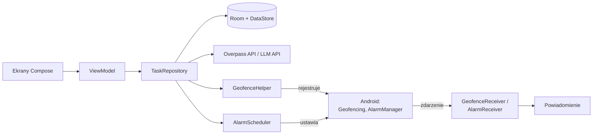

# HLD – Blisko: kalendarz z notatkami i przypomnieniami lokalizacyjnymi (Android/Kotlin)

Stan na: 2026-10-22 · Wersja skrócona (ekrany + architektura na jednej stronie): [HLD-skrot.md](HLD-skrot.md) · Makieta: [Figma Make](https://www.figma.com/make/fm86xhhltRsuyyrgeF4j7U/Android-Task-Reminder-App)

## 1. Cel i zakres

Aplikacja na Androida (Kotlin) łączy kalendarz, notatki i przypomnienia: zadanie przypomina o sobie o określonej godzinie albo gdy użytkownik znajdzie się w pobliżu miejsca, w którym da się je wykonać. Projekt powstaje na zajęcia „Aplikacje mobilne” (AGH).

**W zakresie (MVP):**

- Kalendarz (widok miesiąca i tygodnia) z zadaniami.
- Notatki przypięte do zadania lub dnia.
- Przypomnienia czasowe (o konkretnej godzinie, z wyprzedzeniem).
- Przypomnienia lokalizacyjne: zadanie ma miejsce konkretne (np. paczkomat WAW123) albo kategorię miejsc (np. market budowlany); przebywanie w strefie wywołuje powiadomienie.
- Stałe miejsca użytkownika: DOM i PRACA oraz inne zapisane miejsca (np. „Mama”).
- AI, które z tekstu zadania proponuje podzadania i lokalizację.

**Poza zakresem:** synchronizacja między urządzeniami, współdzielenie kalendarza, iOS, integracja z Google Calendar.

## 2. Wymagania

**Funkcjonalne**

| ID | Wymaganie |
| --- | --- |
| F1 | Użytkownik tworzy, edytuje i usuwa zadania z datą, godziną, opisem i podzadaniami. |
| F2 | Zadanie może mieć przypomnienie czasowe, lokalizacyjne lub oba. |
| F3 | Lokalizacja zadania: KONKRETNY_PUNKT (pinezka / adres / miejsce z listy „W pobliżu”), KATEGORIA (np. apteka), DOM, PRACA lub inne zapisane miejsce. |
| F4 | Użytkownik ustawia DOM i PRACA na mapie i może dodawać kolejne zapisane miejsca. |
| F5 | AI proponuje podzadania i lokalizację; użytkownik akceptuje lub poprawia. |
| F6 | Powiadomienie lokalizacyjne pojawia się po 60 s przebywania w strefie. |
| F7 | Z powiadomienia można: oznaczyć jako zrobione, odłożyć, otworzyć nawigację. |
| F8 | Notatki można tworzyć dla dnia lub zadania, przypinać, filtrować i przeszukiwać. |
| F9 | W Ustawieniach użytkownik ustawia ciszę nocną, domyślny promień strefy (300 m) i domyślne wyprzedzenie przypomnienia (15 min). |

**Niefunkcjonalne**

| ID | Wymaganie |
| --- | --- |
| N1 | Bateria: aplikacja nie odpytuje GPS w tle – używa tylko systemowego geofencingu. |
| N2 | Offline: zadania, notatki i przypomnienia czasowe działają bez internetu. Sieć potrzebna tylko do AI i wyszukiwania miejsc. |
| N3 | Prywatność: pozycja użytkownika nie jest zapisywana ani wysyłana; do AI trafia tylko treść zadania. |
| N4 | minSdk 26, targetSdk 35; obsługa uprawnień Androida 10+ (lokalizacja w tle) i 13+ (powiadomienia). |
| N5 | Przypomnienia przetrwają restart telefonu. |

## 3. Ekrany

Zgodnie z makietą w Figmie. Nawigacja: dolny pasek **Kalendarz · Notatki · Miejsca · Ustawienia**; edytor zadania i wybór miejsca otwierają się na wierzchu jako dolne arkusze (bottom sheet).

| Ekran | Co na nim jest |
| --- | --- |
| **Kalendarz** (start) | Nagłówek z dzisiejszą datą · widok tydzień/miesiąc (przełącznik T/M, strzałki), kropki przy dniach z zadaniami · „Do zrobienia” z liczbą otwartych zadań · karty zadań (checkbox, opis, pinezka z miejscem lub zegar z godziną) · **+ Nowe zadanie** |
| **Edycja zadania** (arkusz) | **Anuluj / Zapisz** · nazwa, opis · **Podpowiedz z AI** (podzadania i miejsce) · **KIEDY:** data, godzina, przypomnienie (o czasie / 5 / 15 / 30 min / 1 godz. wcześniej) · **GDZIE:** wybrane miejsce z promieniem → wybór miejsca · **PODZADANIA:** lista + „Dodaj” |
| **Wybór miejsca** (arkusz) | **Zamknij / Gotowe** · wyszukiwarka adresu/nazwy · mapa z pinezką i okręgiem promienia · kategorie: Sklep, Apteka, Paczkomat, Inne · lista „W pobliżu” (nazwa, godziny otwarcia, odległość) |
| **Notatki** | Wyszukiwarka · filtry **Wszystkie / Przypięte / Powiązane** · karty notatek z datą i powiązaniem · **+** |
| **Miejsca** | Mini-mapa z pinezkami · Dom, Praca i inne zapisane miejsca z adresem i liczbą zadań · **Dodaj nowe miejsce** |
| **Ustawienia** | Panel stanu („Przypomnienia działają”) · **Uprawnienia:** powiadomienia, lokalizacja „Zawsze” · **Przypomnienia:** cisza nocna, domyślny promień, domyślne wyprzedzenie · informacja o prywatności lokalizacji |
| **Powiadomienie** (poza makietą) | „Jesteś blisko: Sklep budowlany – Kupić żarówki” · **Zrobione**, **Później**, **Nawiguj** |

## 4. Architektura

Jeden moduł Gradle `app`, wzorzec MVVM: ekran Compose → ViewModel → repozytorium → Room / API. Bez osobnej warstwy domeny, bez backendu, DI ręcznie przez jeden obiekt `AppContainer` tworzony w klasie `Application`.



| Pakiet | Zawartość |
| --- | --- |
| `ui/` | Ekrany Compose (`CalendarScreen`, `TaskEditScreen`, `PlacePickerScreen`, `NotesScreen`, `PlacesScreen`, `SettingsScreen`), ViewModel na ekran, `AppNavHost` |
| `data/` | Encje i DAO Room, `AppDatabase`, `TaskRepository`, `NoteRepository`, `SettingsStore` (DataStore) |
| `location/` | `GeofenceHelper` (dodaj/usuń strefy), `GeofenceReceiver`, `PlacesApi` (Overpass) |
| `reminders/` | `AlarmScheduler`, `AlarmReceiver`, `BootReceiver`, `Notifications` (kanały, akcje) |
| `ai/` | `AiClient` – jedno zapytanie do LLM, odpowiedź w JSON |

## 5. Przypomnienia lokalizacyjne

Aplikacja nie śledzi użytkownika: rejestruje w systemie okręgi (geofence) wokół miejsc z zadań, a Android budzi ją, gdy użytkownik w nich przebywa.

1. **Zapis zadania z lokalizacją** – `TaskRepository` ustala punkty:
    - KONKRETNY_PUNKT, DOM, PRACA, inne zapisane miejsce → jeden punkt;
    - KATEGORIA → do 5 najbliższych miejsc wokół DOM i PRACA (Overpass, promień wyszukiwania 5 km), zapisanych w Room.
2. **Rejestracja** – `GeofenceHelper` dodaje dla każdego punktu geofence o promieniu z ustawień (domyślnie 300 m), typ `DWELL`, `loiteringDelay = 60 s`. Id strefy: `task:<taskId>:<placeId>`.
3. **Zdarzenie** – `GeofenceReceiver` dostaje DWELL, sprawdza w Room, że zadanie jest nadal aktywne i że ostatnie przypomnienie było > 4 h temu, nie trwa cisza nocna – wtedy pokazuje powiadomienie.
4. **Sprzątanie** – oznaczenie zadania jako zrobione lub usunięcie go usuwa jego strefy; `BootReceiver` rejestruje wszystkie strefy ponownie po restarcie.

DWELL 60 s odfiltrowuje przejazd obok sklepu, więc nie potrzebujemy Activity Recognition. Limit Androida to 100 geofence’ów na aplikację; przy przekroczeniu rejestrujemy zadania z najbliższym terminem. Dokładność geofencingu to ok. 100–200 m, a zdarzenie może przyjść z opóźnieniem do kilku minut.

## 6. AI i wyszukiwanie miejsc

AI tylko proponuje – użytkownik akceptuje sugestię jednym kliknięciem. `AiClient` wysyła tekst zadania i oczekuje JSON:

```json
{
  "subtasks": [
    {"title": "Kupić żarówki", "location": {"type": "CATEGORY", "category": "hardware_store"}},
    {"title": "Odebrać paczkę", "location": {"type": "POINT", "query": "Paczkomat WAW123"}}
  ]
}
```

- Kategorie to zamknięta lista w aplikacji (`grocery`, `pharmacy`, `hardware_store`, `parcel_locker`, `post_office`, `atm`), każda zmapowana na tag OpenStreetMap (np. `shop=hardware`).
- Klucz API w `local.properties` → `BuildConfig`. Wystarcza w projekcie zaliczeniowym; w publicznej aplikacji klucz musiałby siedzieć na serwerze.
- Bez sieci przycisk AI jest nieaktywny – resztę zadania wypełnia się ręcznie.
- W wyborze miejsca widoczne są kategorie Sklep, Apteka, Paczkomat; „Inne” rozwija pozostałe. Lista „W pobliżu” pokazuje wyniki Overpass z odległością i godzinami otwarcia (tag `opening_hours`, jeśli jest).
- Adres KONKRETNEGO_PUNKTU zamieniamy na współrzędne przez `Geocoder` Androida albo pinezkę na mapie.

## 7. Model danych (Room)

| Encja | Pola |
| --- | --- |
| `Task` | id, title, description, dueAt?, done, parentId? (podzadania), locationType (NONE/POINT/CATEGORY/HOME/WORK), category?, remindMinutesBefore?, lastNotifiedAt? |
| `Note` | id, taskId?, date?, title, content, pinned, updatedAt |
| `Place` | id, name, lat, lng, category?, kind (HOME/WORK/SAVED/POI) |
| `TaskPlace` | taskId, placeId – punkty, dla których zarejestrowano strefy |

Ustawienia (cisza nocna od–do, promień strefy, domyślne wyprzedzenie) trzymamy w DataStore, nie w Room.

## 8. Powiadomienia i uprawnienia

- **Przypomnienia czasowe:** `AlarmManager.setExactAndAllowWhileIdle` → `AlarmReceiver`. Bez zgody na dokładne alarmy – `setWindow` (tolerancja kilku minut).
- **Kanały:** „Przypomnienia czasowe” i „W pobliżu”. Akcje: Zrobione, Później (+1 h), Nawiguj (intencja `geo:`).
- **Uprawnienia** (pytamy w momencie potrzeby):
    1. `POST_NOTIFICATIONS` – przy pierwszym przypomnieniu.
    2. `ACCESS_FINE_LOCATION` – przy pierwszym zadaniu z lokalizacją.
    3. `ACCESS_BACKGROUND_LOCATION` – osobny ekran z wyjaśnieniem; bez „Zezwalaj zawsze” geofencing nie działa, a aplikacja pozostaje kalendarzem z przypomnieniami czasowymi.
    4. `SCHEDULE_EXACT_ALARM` – opcjonalnie.

## 9. Technologie

Kotlin · Jetpack Compose (Material 3) · Navigation Compose · ViewModel + Coroutines/Flow · Room (KSP) · DataStore · Retrofit + kotlinx.serialization · Google Play Services Location · osmdroid lub Google Maps Compose · testy: JUnit, Room in-memory.

## 10. Ryzyka

| Ryzyko | Co robimy |
| --- | --- |
| Brak zgody na lokalizację w tle | Ekran z wyjaśnieniem; reszta aplikacji działa |
| Producenci zabijają aplikacje w tle (Xiaomi, Huawei) | Podpowiedź w Ustawieniach, by wyłączyć optymalizację baterii |
| Opóźnione zdarzenia geofence | Domyślny promień 300 m (konfigurowalny); traktujemy jako ograniczenie platformy |
| Emulator bez Google Play Services | Testy na obrazie „Google APIs”, mock lokalizacji z Extended Controls |

## 11. Plan realizacji

1. Projekt, Room, nawigacja, ekran Kalendarz + Edycja zadania (CRUD).
2. Notatki.
3. Przypomnienia czasowe i powiadomienia z akcjami.
4. Miejsca: DOM/PRACA i inne zapisane, wybór punktu na mapie, Ustawienia.
5. Geofencing dla punktów (DWELL, `BootReceiver`).
6. Kategorie miejsc przez Overpass.
7. AI: podpowiedzi podzadań i lokalizacji.
8. Testy na telefonie, prezentacja.

Etapy 1–5 to działające MVP; 2, 6 i 7 mogą robić różne osoby równolegle.
